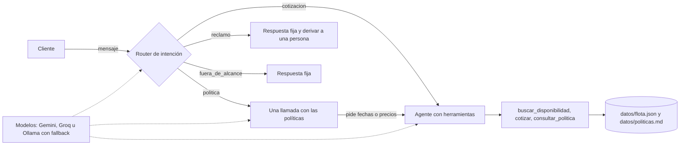

# asistente-flota-mcp


Asistente que responde disponibilidad, tarifas y políticas de una flota de alquiler, expuesto como servidor MCP, como agente con tool use y como flujo de n8n.

> **Caso:** Rentadora de autos de Bariloche (basado en Proper Rent a Car, datos ficticios). Todos los datos de este repo son ficticios.
> Proyecto 1 del programa *30 días de IA aplicada* (Fundamentos y Claude como herramienta de trabajo).

## Demo

Preguntarle al asistente (desde Claude o desde un chat web/n8n) qué autos hay libres para ciertas fechas, cuánto sale y si se puede cruzar a Chile.

_(GIF o video de la demo: se agrega al cerrar el proyecto)_

## Qué sabe hacer el asistente

- ✓ Responder políticas de la rentadora (requisitos, garantía, Chile, mascotas, pagos) citando la política
- ✓ Buscar autos libres por fechas y categoría con datos del sistema (ficticios)
- ✓ Cotizar con temporada alta y cargos extra, sin inventar precios
- ✓ Elegir el camino según la intención: políticas, cotización, reclamo o fuera de alcance
- ✓ Derivar reclamos a una persona sin gastar llamadas de más
- ✓ Seguir funcionando si un proveedor falla (Gemini, Groq, Ollama)
- Próximamente: reservas con confirmación (L06), persistencia en base de datos (L07), manual con citas (L08 a L11)

## Arquitectura



_(Se actualiza a medida que se suman módulos.)_

## Stack

Python 3.12, SDK oficial de MCP, API de LLM con fallback gratuito, n8n, Docker, GitHub Actions

## Cómo correrlo

```bash
git clone https://github.com/JaimeLopezGarrido/asistente-flota-mcp.git && cd asistente-flota-mcp
python3 -m venv .venv && source .venv/bin/activate
pip install -r requirements-dev.txt
cp .env.example .env   # completar claves
pytest

# Probar el asistente contra los 10 casos difíciles (usa las claves de .env)
python -m scripts.correr_casos --repeticiones 3
```

## Probar el agente

```bash
python -m scripts.chat                       # chat en la terminal (usa las claves de .env)
python -m scripts.chat --proveedores groq    # forzar un proveedor
python -m scripts.streaming                  # demo de streaming
```

## Probar el router

```bash
python -m scripts.atender                 # chat que muestra la ruta elegida
python -m scripts.atender --detalle       # con los logs del router
python -m scripts.comparar_costos         # tokens estimados: todo al agente vs con router
```

## Exploración: cómo funciona un LLM por dentro

```bash
python -m exploracion.tokens                            # cómo se tokenizan frases de la rentadora
python -m exploracion.probabilidades                    # temperatura, top-p y muestreo con numpy
python -m exploracion.logprobs_ollama --temperatura 0   # opcional: logprobs reales con Ollama
```

## Roadmap

Cada ítem es una issue; se cierra con el commit que la resuelve (`Closes #N`).

- [ ] L01 · Cómo funciona un LLM hoy y el mapa de modelos
- [x] L02 · Context engineering y prompting profesional
- [x] L03 · LLMs desde código: API, streaming y tool use
- [x] L04 · Cómo se entrena un LLM y qué es un transformer
- [x] L05 · Workflows vs agentes: los patrones que funcionan
- [ ] L06 · Herramientas profesionales: diseño, validación y escritura segura
- [ ] L07 · Persistencia: reservas y conversaciones en una base de datos
- [ ] L08 · Embeddings y búsqueda semántica desde cero
- [ ] L09 · Ingesta de documentos: PDF, chunking y metadatos
- [ ] L10 · Base vectorial: indexar y recuperar
- [ ] L11 · Respuestas con citas y RAG como herramienta del agente
- [ ] L12 · RAG avanzado: híbrido, reranking y reescritura
- [ ] … (memoria, evals, seguridad, API web y demo pública)

## Decisiones

Ver [docs/decisiones/](docs/decisiones/).

## Licencia

MIT

