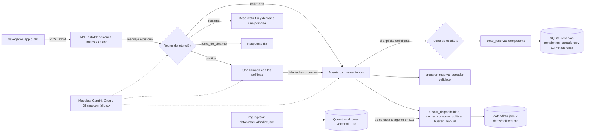

# asistente-flota-mcp


Asistente que responde disponibilidad, tarifas y políticas de una flota de alquiler, expuesto como servidor MCP, como agente con tool use y como flujo de n8n.

> **Caso:** Rentadora de autos de Bariloche (basado en Proper Rent a Car, datos ficticios). Todos los datos de este repo son ficticios.
> Proyecto 1 del programa *30 días de IA aplicada* (Fundamentos y Claude como herramienta de trabajo).

## Demo

Preguntarle al asistente (desde Claude o desde un chat web/n8n) qué autos hay libres para ciertas fechas, cuánto sale y si se puede cruzar a Chile.

_(GIF o video de la demo: se agrega al cerrar el proyecto)_

## Qué sabe hacer el asistente

- ✓ Responder políticas de la rentadora (requisitos, garantía, Chile, mascotas, pagos) citando la política
- ✓ Buscar autos libres por fechas y categoría con datos del sistema (ficticios)
- ✓ Cotizar con temporada alta y cargos extra, sin inventar precios
- ✓ Elegir el camino según la intención: políticas, cotización, reclamo o fuera de alcance
- ✓ Derivar reclamos a una persona sin gastar llamadas de más
- ✓ Seguir funcionando si un proveedor falla (Gemini, Groq, Ollama)
- ✓ Atender por una API web (FastAPI): sesiones, límites de uso, errores claros y CORS configurable
- ✓ Responder con el manual del cliente (RAG): búsqueda híbrida y citas de página [pág. N]
- ✓ Demo pública con interfaz web: https://asistente-rentadora-demo.vercel.app
- ✓ Dejar una reserva pendiente de aprobación en dos pasos (borrador y sí explícito del cliente), sin duplicados
- ✓ Consultar varias herramientas de lectura a la vez, con timeout, sin cortarse si una falla
- ✓ Guardar reservas y conversaciones en una base SQLite: sobreviven a un reinicio y un auto reservado deja de ofrecerse
- ✓ Explicar con números por qué encuentra cada parte del manual: embeddings y similitud coseno a mano, con un modelo en la nube (Gemini) o local (EmbeddingGemma)
- ✓ Leer PDFs armados como los reales (encabezados, pies de página, secciones que cruzan páginas y tablas) y comparar estrategias de chunking con metadatos de página y sección
- ✓ Guardar el manual en una base vectorial local (Qdrant) y mostrar los fragmentos más parecidos con página, sección y puntaje, con filtros por metadatos
- Próximamente: RAG más profundo (L11 a L13), memoria (L14) y aprobación humana (L15)

## Arquitectura



_(Se actualiza a medida que se suman módulos.)_

## Stack

Python 3.12, SQLite, SDK oficial de MCP, API de LLM con fallback gratuito, n8n, Docker, GitHub Actions

## Cómo correrlo

```bash
git clone https://github.com/JaimeLopezGarrido/asistente-flota-mcp.git && cd asistente-flota-mcp
python3 -m venv .venv && source .venv/bin/activate
pip install -r requirements-dev.txt
cp .env.example .env   # completar claves
pytest

# Probar el asistente contra los 10 casos difíciles (usa las claves de .env)
python -m scripts.correr_casos --repeticiones 3
```

## Probar el agente

```bash
python -m scripts.chat                       # chat en la terminal (usa las claves de .env)
python -m scripts.chat --proveedores groq    # forzar un proveedor
python -m scripts.streaming                  # demo de streaming
```

## Demo online

https://asistente-rentadora-demo.vercel.app (datos ficticios). Debajo de cada respuesta se ve la ruta del router, las herramientas usadas, el proveedor y las páginas del manual citadas.

## Probar el RAG

~~~bash
python -m scripts.generar_manual    # regenera el PDF desde datos/manual/manual_rentadora.md
python -m rag.ingesta               # PDF -> fragmentos -> embeddings -> datos/manual/indice.json
python -m rag.buscar "¿qué hago si pincho una goma?"   # muestra los fragmentos con su página
~~~

## Probar la base vectorial

~~~bash
python -m rag.vectorial --indexar                       # carga indice.json en Qdrant local (datos/vectorial/)
python -m rag.vectorial '¿Puedo cruzar a Chile?'        # top-3 con página, sección y puntaje
python -m rag.vectorial --secciones                     # secciones para filtrar
python -m rag.vectorial 'mascotas' --k 5 --seccion '10. Preguntas frecuentes'
python -m rag.vectorial 'pinché una goma' --comparar    # compara con la búsqueda exacta a mano
~~~

La carpeta datos/vectorial/ no se versiona: se regenera desde indice.json. Decisión: ADR 0013.

## Probar la API web

~~~bash
python -m uvicorn api.main:app --reload   # y abrir http://127.0.0.1:8000/docs
curl -s -X POST http://127.0.0.1:8000/chat -H 'Content-Type: application/json' -d '{"mensaje": "¿Aceptan mascotas?"}'
~~~

`POST /chat` recibe `mensaje` y `sesion_id` (opcional) y devuelve la respuesta con la ruta del router, las herramientas usadas y el proveedor. `GET /salud` dice si el servidor está vivo. Límites y orígenes permitidos: ver `.env.example` y el ADR 0006.

## Ver la base de datos

~~~bash
python -m scripts.ver_base                  # versión del esquema, filas por tabla y reservas de la demo
sqlite3 -header -column datos/rentadora.db 'SELECT * FROM reservas;'
~~~

La base se crea sola desde `datos/flota.json` la primera vez. Para empezar de cero: `rm datos/rentadora.db*`.

## Probar el router

```bash
python -m scripts.atender                 # chat que muestra la ruta elegida
python -m scripts.atender --detalle       # con los logs del router
python -m scripts.comparar_costos         # tokens estimados: todo al agente vs con router
```

## Exploración: cómo funciona un LLM por dentro

```bash
python -m exploracion.tokens                            # cómo se tokenizan frases de la rentadora
python -m exploracion.probabilidades                    # temperatura, top-p y muestreo con numpy
python -m exploracion.logprobs_ollama --temperatura 0   # opcional: logprobs reales con Ollama
python -m exploracion.embeddings                        # embeddings y similitud coseno a mano (L08)
python -m exploracion.embeddings --trampas              # casos donde la similitud engaña
python -m scripts.generar_folleto                       # folleto PDF de práctica (L09)
python -m exploracion.chunking                          # 4 estrategias de chunking y qué se pierde
```

## Roadmap

Cada ítem es una issue; se cierra con el commit que la resuelve (`Closes #N`).

- [ ] L01 · Cómo funciona un LLM hoy y el mapa de modelos
- [x] L02 · Context engineering y prompting profesional
- [x] L03 · LLMs desde código: API, streaming y tool use
- [x] L04 · Cómo se entrena un LLM y qué es un transformer
- [x] L05 · Workflows vs agentes: los patrones que funcionan
- [x] L06 · Herramientas profesionales: diseño, validación y escritura segura
- [x] L07 · Persistencia: reservas y conversaciones en una base de datos
- [x] L08 · Embeddings y búsqueda semántica desde cero
- [x] L09 · Ingesta de documentos: PDF, chunking y metadatos
- [x] L10 · Base vectorial: indexar y recuperar
- [ ] L11 · Respuestas con citas y RAG como herramienta del agente
- [ ] L12 · RAG avanzado: híbrido, reranking y reescritura
- [x] E1 · Sprint: el chatbot como API web con FastAPI
- [x] E2 a E4 · Sprints: RAG simple con citas, interfaz web y demo pública en Vercel
- [ ] … (memoria, evals y seguridad)

## Decisiones

Ver [docs/decisiones/](docs/decisiones/).

## Licencia

MIT

