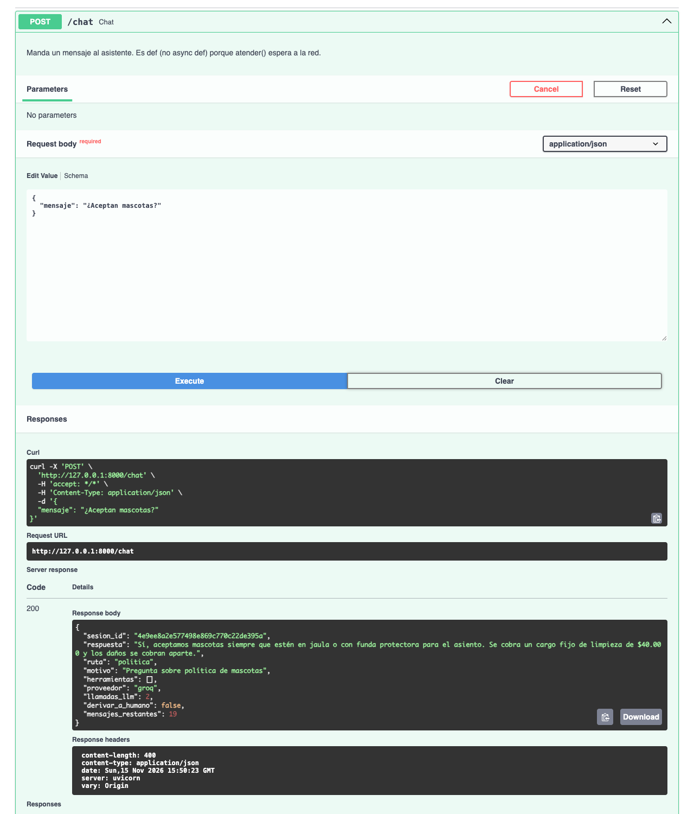
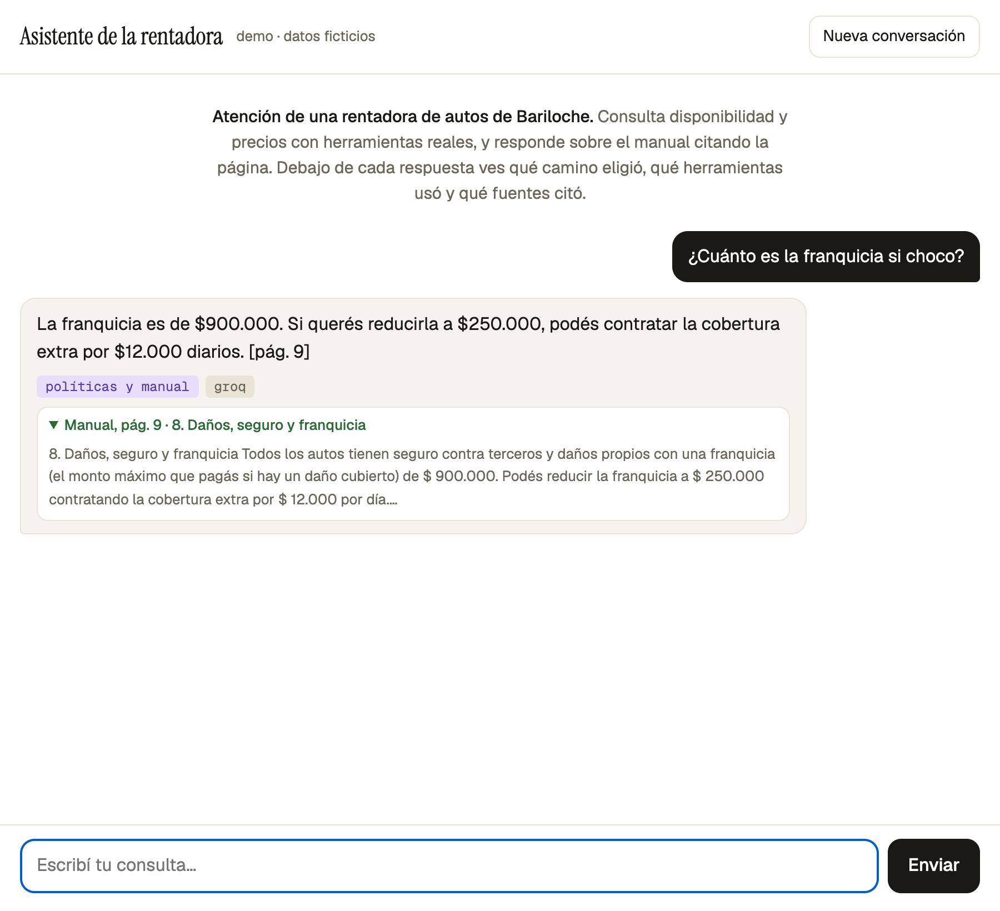

# Bitácora del proyecto

Qué construí en cada sesión, qué decidí y cómo lo explicaría. Todos los datos del proyecto son ficticios.

## L02 · Prompt profesional y salida estructurada

**Qué construí:** el system prompt del asistente con etiquetas XML, reglas que explican el porqué, ejemplos y las políticas numeradas; y una salida JSON validada con Pydantic (intención, respuesta, datos faltantes, derivar a humano y políticas usadas).

**Decisión y trade-off:** elegí salida estructurada con JSON schema en vez de texto libre: el código puede decidir (por ejemplo, derivar a una persona) sin adivinar. A cambio, el prompt es más largo y algunos proveedores no combinan esquema con herramientas.

**Evidencia:** `python -m scripts.correr_casos --repeticiones 3` corre 10 casos difíciles (inyección, reclamos, fechas ambiguas) y muestra cuántos cumplen.

**Cómo lo explicaría:** Antes de escribir código, diseñé las instrucciones del asistente como un documento con secciones y reglas justificadas. Le pedí al modelo que siempre conteste en un formato fijo, así el sistema sabe cuándo derivar a una persona. Armé 10 casos difíciles para medir si cumple, en vez de confiar en que funciona. Eso me permite cambiar el prompt sin miedo a romper algo.

## L03 · Function calling y fallback de proveedores

**Qué construí:** un agente con tool use sobre la flota ficticia: herramientas de disponibilidad, cotización y políticas, con el loop de herramientas, límite de vueltas y fallback entre Gemini, Groq y Ollama.

**Decisión y trade-off:** los precios los calcula siempre el código, nunca el modelo: más llamadas, pero cero montos inventados. Usé el formato compatible con OpenAI para cambiar de proveedor sin reescribir el agente.

**Evidencia:** `python -m pytest tests/test_agente.py tests/test_herramientas.py -q` en verde, y `python -m scripts.chat` respondiendo una cotización con las herramientas usadas.

**Cómo lo explicaría:** El modelo entiende lo que pide el cliente, pero los datos salen del sistema: cuando hace falta un precio, el modelo pide la herramienta y mi código la ejecuta. Así el asistente no inventa disponibilidad ni tarifas. Si un proveedor falla o se queda sin cuota, pasa al siguiente sin que el cliente lo note. Y tiene un límite de vueltas para que nunca quede en un loop.

## L04 · Tokens, temperatura y RAG vs fine-tuning

**Qué construí:** scripts en exploracion/ que muestran cómo se tokeniza un mensaje y cómo la temperatura y top-p cambian las probabilidades del próximo token (numpy y logprobs con Ollama). Y el ADR 0004.

**Decisión y trade-off:** el conocimiento del negocio va por herramientas y RAG, no por fine-tuning: se actualiza editando datos, sin reentrenar, y permite citar la fuente. Fine-tuning queda para cambiar estilo o formato si algún día hace falta.

**Evidencia:** `python -m exploracion.probabilidades` muestra la misma distribución con temperatura 0,2, 1 y 2.

**Cómo lo explicaría:** Quise entender qué pasa adentro del modelo para tomar mejores decisiones técnicas. Por eso uso temperatura baja donde necesito respuestas estables. También documenté por qué no entreno un modelo propio: las políticas y la flota cambian seguido y es más barato y seguro que el modelo las consulte. Cada decisión importante queda escrita en un ADR.

## L05 · Router de intención antes del agente

**Qué construí:** un router que clasifica cada mensaje (política, cotización, reclamo o fuera de alcance) y lo manda al camino más simple que lo resuelve: una llamada para políticas, el agente para cotizar y respuestas fijas para reclamos y consultas ajenas.

**Decisión y trade-off:** elegí workflow por fuera y agente por dentro, en vez de mandar todo al agente. Gano menos tokens en promedio y reclamos que llegan a una persona sin vueltas; a cambio, las cotizaciones suman una llamada. Descarté reglas por palabras clave (fallan con mensajes mezclados) y un framework de agentes (demasiado para cuatro rutas).

**Evidencia:** `python -m scripts.comparar_costos`: 2660 tokens de entrada por mensaje solo con el agente contra 2240 con router (16 % menos), con 2,10 contra 2,45 llamadas por mensaje. 24 tests nuevos en verde.

**Cómo lo explicaría:** No todos los mensajes necesitan un agente con herramientas. Puse un clasificador en la puerta que decide el camino: las preguntas de políticas se responden con una sola llamada y los reclamos van directo a una persona. El agente queda para lo que de verdad es abierto, como cotizar con fechas. Medí el efecto en tokens antes de afirmarlo, y si el clasificador falla, el sistema usa el camino más capaz en lugar de cortarse.

## E1 · El chatbot como API web con FastAPI

**Qué construí:** una API web con FastAPI delante del asistente. `POST /chat` recibe el mensaje y un id de sesión y devuelve la respuesta con la ruta que eligió el router, las herramientas usadas y el proveedor que respondió; `GET /salud` sirve para monitoreo. Guarda el historial por sesión, limita el uso por sesión y por minuto y responde errores claros (422, 429 y 503).

**Decisión y trade-off:** elegí FastAPI con sesiones en memoria y límites propios en vez de una base de datos y una librería de rate limiting: menos piezas para una demo de un solo proceso. A cambio, las conversaciones se pierden al reiniciar y no escala a varios procesos (queda para L07). CORS con la lista exacta de orígenes por variable de entorno, nunca `*`, para que otra web no pueda gastar la cuota de la demo.

**Evidencia:** `python -m pytest -q` en verde, con 16 tests nuevos de la API (TestClient y proveedores falsos, sin internet), y la documentación automática funcionando:

**Cómo lo explicaría:** El asistente ya no vive solo en mi terminal: cualquier web, app o flujo de n8n le puede hablar por HTTP con un contrato documentado en /docs. Cada respuesta dice qué camino tomó, qué herramientas usó y qué modelo contestó, así puedo comprobar que no inventa. Antes de abrirlo al público le puse límites de uso, porque una demo sin límites se queda sin cuota en minutos. Y los errores son claros para el usuario sin mostrar detalles internos.

### Cómo lo cuento en la entrevista

**ES:** Convertí un asistente que solo andaba en mi terminal en un servicio web con un contrato claro y documentado automáticamente. Cada respuesta muestra la ruta del router, las herramientas usadas y el proveedor, y eso me permite validar que la IA no inventa datos y depurar rápido. Lo protegí con límites de uso y errores claros antes de publicarlo, con tests que no dependen de ningún proveedor. Lo entregué en un PR chico con CI en verde y dejé anotado lo que sigue (persistencia) para la próxima iteración.

**EN:** I turned an assistant that only ran in my terminal into a web service with a clear, auto-documented contract. Every response shows the router's route, the tools used and the provider that answered, which lets me verify the AI isn't making data up and debug quickly. I added usage limits and clear error handling before making it public, covered by tests that don't depend on any LLM provider. I shipped it as a small PR with green CI and documented the next step (persistence) for the following iteration.

## E2 a E4 · RAG con citas, interfaz web y demo pública

**Qué construí:** el asistente ahora responde con un manual del cliente en PDF: lo corta en fragmentos con su página, los indexa con embeddings y búsqueda por palabras, y cada respuesta cita la página de donde sale. Sumé una interfaz web que muestra la ruta, las herramientas y las fuentes, y lo publiqué en Vercel: https://asistente-rentadora-demo.vercel.app

**Decisión y trade-off:** búsqueda híbrida (embeddings + BM25) en un índice JSON en lugar de una base vectorial: para 21 fragmentos es instantáneo y no suma infraestructura, y si Gemini se cae la búsqueda sigue por palabras. Las citas las exijo en la salida estructurada (campo paginas_manual) porque en la prueba real el modelo solo citaba la mitad de las veces.

**Evidencia:** 114 tests en verde; prueba real: "¿Qué hago si pincho una goma?" responde citando [pág. 7], "capital de Francia" queda fuera de alcance, y la consulta de una camioneta a Chile usa buscar_disponibilidad y cotizar.

**Cómo lo explicaría:** Un chatbot que inventa es peor que no tener chatbot. Por eso cada dato sale de una herramienta o de un documento, y cada respuesta muestra de dónde salió: el usuario y yo podemos verificarlo. Cuando el modelo no citaba, no le pedí "por favor citá": lo hice obligatorio en el formato de salida y lo controla el código.

### Cómo lo cuento en la entrevista

**ES:** Lo dejé online en un día: RAG con citas, interfaz que muestra cómo decidió cada respuesta, y deploy gratuito con límites de uso. Cuando vi en la prueba real que el modelo no citaba siempre, lo resolví en el esquema y no en el prompt, y cuando Groq se quedó sin cupo, sumé un segundo modelo de respaldo.

**EN:** I shipped it in a day: RAG with citations, a UI that shows how each answer was produced, and a free deployment with usage limits. When real tests showed the model didn't always cite its sources, I enforced it in the output schema instead of the prompt, and when Groq hit its rate limit I added a second fallback model.

## L06 · Herramientas de escritura: reservas con confirmación e idempotencia

**Qué construí:** el asistente ya puede dejar una reserva pendiente de aprobación, en dos pasos: `preparar_reserva` valida los datos, re-verifica que el auto siga libre y devuelve un borrador con el total; `crear_reserva` lo convierte en reserva solo si el cliente confirmó. Además, el agente corre en paralelo las lecturas de un mismo turno, con timeout, y un bug en una herramienta vuelve como dato en vez de cortar la conversación.

**Decisión y trade-off:** la confirmación se controla en código, con una puerta de escritura: una escritura por turno, nunca en el mismo pedido en que se creó el borrador y solo con un sí claro del cliente. El id del borrador es un hash de los datos, así el sí queda atado a esos datos exactos y repetir la llamada (por un reintento o un fallback de proveedor) no duplica la reserva. A cambio, la regla es conservadora: ante un “sí, pero…” vuelve a preguntar. Descarté confiar solo en el prompt y un campo `confirmado` que el modelo podría completar solo.

**Evidencia:** `python -m pytest -q` en verde con 32 tests nuevos (`tests/test_reservas.py` y `tests/test_agente_escritura.py`): diez confirmaciones simultáneas crean una sola reserva, un borrador vencido se rechaza y, si el proveedor se cae después de escribir, el reintento con otro proveedor devuelve la misma reserva.

**Cómo lo explicaría:** Leer datos es barato si sale mal; escribir no. Por eso el asistente nunca reserva en el primer mensaje: arma un borrador, se lo muestra al cliente y espera un sí explícito. Esa regla no depende de que el modelo se porte bien: la controla el código. Y como en sistemas reales todo se reintenta (un timeout, un proveedor caído, un doble clic), cada reserva tiene una clave única que evita duplicados. Lo probé con tests que simulan justamente esos fallos.
